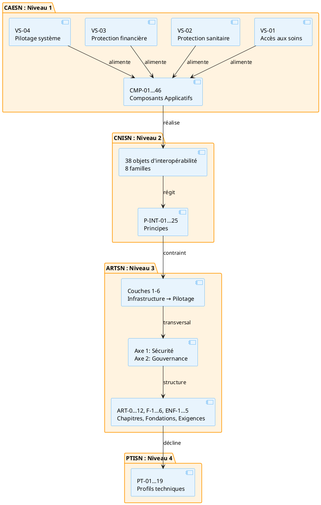

Cette annexe documente le flux complet depuis les **capabilités métier** (CAESN, niveau 1) jusqu'aux **profils techniques** (PTISN, niveau 4), en passant par les **objets d'interopérabilité** (CNISN, niveau 2) et l'**architecture de référence** (ARTSN, niveau 3).

Les matrices de cette annexe sont une projection du référentiel d'architecture : les relations entre objets y sont portées par le frontmatter des fiches canoniques (`maps_to`, `implements`, `applies_to`, `related`). Une cellule vide signifie que le référentiel ne déclare pas de lien de ce type. Elles ne constituent donc pas une source de vérité autonome, mais un rendu de la source de vérité unique.

## 1. Vue d'ensemble des niveaux

| Niveau | Cadre | Contenu | Objets principaux |
|--------|-------|---------|-------------------|
| **1** | CAESN | Capabilités métier du système de santé | 18 capabilités (`CAP-01…18`), 4 flux de valeur (`VS-01…04`), 28 étapes (`VS-01-01…28`), 13 processus (`PRC-01…13`) |
| **2** | CNISN | Objets d'interopérabilité et principes | 38 objets répartis en 8 familles, 25 principes (`P-INT-01…25`) |
| **3** | ARTSN | Architecture technique de référence | 21 chapitres (`ART-0…12`, `ART-4A…4D`, `ART-8A…8D`), 6 fondations (`F-1…6`), 5 exigences (`ENF-1…5`) |
| **4** | PTISN | Profils techniques d'implémentation | 19 profils (`PT-01…19`) |

**Couche de liaison :** 46 composants (`CMP-01…46`) relient les capabilités métier (CAESN) et les objets d'interopérabilité (CNISN) via l'architecture technique (ARTSN). Ils se répartissent en six couches applicatives, une couche d'infrastructure, un axe sécurité et un axe gouvernance.

## 2. Chaîne de valeur des niveaux

## 3. Matrice d'articulation par famille d'objets

Les huit familles reprennent le découpage du chapitre Partie II du CNISN. Chaque ligne établit la chaîne reliant un objet d'interopérabilité aux composants qui le réalisent, aux chapitres qui l'encadrent et aux profils qui le déclinent.

### 3.1 Famille 1 : Référentiels et identités

| Objet CNISN/TOGAF | Composants applicatifs | Chapitres ARTSN | Profils PTISN |
|----------------|------------------------|-----------------|---------------|
| **ABB-IDENTITE-BENEFICIAIRE** Résolution d'identité du bénéficiaire | CMP-06 Intégration | ART-4, ART-4A, ART-7 | PT-04 |
| **ABB-REGISTRE-PROFESSIONNELS** Registre et résolution des professionnels de santé | : | ART-4, ART-4A, ART-4C, ART-7 | PT-05 |
| **ABB-REFERENTIEL-STRUCTURES-SERVICES** Référentiel des structures et services de santé | : | ART-4, ART-5, ART-6 | PT-06 |
| **RD-STRUCTURES-SERVICES** Données de référence des structures et services | : | ART-4, ART-5, ART-6 | : |
| **ABB-SERVICE-TERMINOLOGIE** Service de terminologie et codification communes | : | ART-2, ART-4, ART-5 | PT-07, PT-19 |
| **TERM-CODIFICATION-COMMUNE** Terminologie et codification communes | : | ART-2, ART-4, ART-5 | : |

### 3.2 Famille 2 : Échange, médiation et contractualisation

| Objet CNISN/TOGAF | Composants applicatifs | Chapitres ARTSN | Profils PTISN |
|----------------|------------------------|-----------------|---------------|
| **ABB-ECHANGE-MEDIATION** Échange et médiation inter-systèmes | CMP-05 Moteur de graphes, CMP-06 Intégration | ART-1, ART-2, F-3 | PT-01, PT-02, PT-08, PT-16 |
| **PAT-ECHANGE-MEDIATION** Pattern d'échange et médiation | : | ART-1, ART-2, F-3 | : |
| **ABB-CATALOGUE-CONTRATS** Catalogue des services et registre des contrats | : | ART-1, ART-2, F-3, F-4 | PT-03 |
| **AC-CATALOGUE-SERVICES** Contrat d'architecture du catalogue de services | : | ART-1, ART-2, F-3, F-4 | : |

### 3.3 Famille 3 : Données analytiques et exposition

| Objet CNISN/TOGAF | Composants applicatifs | Chapitres ARTSN | Profils PTISN |
|----------------|------------------------|-----------------|---------------|
| **ABB-EXPOSITION-DONNEES-ANALYTIQUES** Accès et exposition des données analytiques | CMP-01 Tableaux de bord, CMP-02 Centre de commande, CMP-03 Entrepôt Lakehouse, CMP-04 Moteur analytique | ART-3, ART-5, ART-6, ART-7 | PT-08, PT-09, PT-18 |

### 3.4 Famille 4 : Confiance, sécurité et autorisation

| Objet CNISN/TOGAF | Composants applicatifs | Chapitres ARTSN | Profils PTISN |
|----------------|------------------------|-----------------|---------------|
| **ABB-CONFIANCE-AUTORISATION** Confiance, sécurité et autorisation | CMP-07 Orchestrateur de parcours, CMP-22 Espace sante patient | ART-0, ART-4B, ART-7, ART-9 | PT-10 |
| **ABB-GESTION-CONSENTEMENT** Gestion des consentements et bases d'autorisation | CMP-08 Répertoire de données cliniques, CMP-09 Référentiel des métadonnées, CMP-10 Registre des terminologies, CMP-11 Registre des clients, CMP-12 Registre d'éligibilité et de, CMP-13 Registre des personnels, CMP-14 Registre des produits, CMP-19 Dossiers, CMP-20 Gestion des pharmacies, CMP-21 Sante communautaire mobile, CMP-25 Enquetes | ART-0, ART-11, ART-4B, ART-7 | PT-11 |
| **ABB-AUDIT-PROVENANCE** Provenance, audit et traçabilité | CMP-04 Moteur analytique, CMP-15 API Gateway, CMP-16 Registre de schémas, CMP-17 Message broker asynchrone, CMP-18 Compensateur, CMP-23 Chaine logistique | ART-3, ART-7, ART-9, F-1, F-5, F-6 | PT-12, PT-17 |

### 3.5 Famille 5 : Qualité et conformité

| Objet CNISN/TOGAF | Composants applicatifs | Chapitres ARTSN | Profils PTISN |
|----------------|------------------------|-----------------|---------------|
| **ABB-RECONCILIATION-DONNEES** Qualité et réconciliation des données | CMP-01 Tableaux de bord, CMP-03 Entrepôt Lakehouse | ART-4, ART-5, ART-6 | PT-13 |
| **PAT-QUALITE-RECONCILIATION** Pattern qualité et réconciliation | : | ART-4, ART-5, ART-6 | : |
| **COMP-HOMOLOGATION-INTEROPERABILITE** Homologation d'interopérabilité | CMP-05 Moteur de graphes | F-4 | PT-01 |
| **EVID-TESTS-INTEROPERABILITE** Preuves de tests d'interopérabilité | : | F-4 | : |

### 3.6 Famille 6 : Interopérabilité transfrontalière

| Objet CNISN/TOGAF | Composants applicatifs | Chapitres ARTSN | Profils PTISN |
|----------------|------------------------|-----------------|---------------|
| **PART-ECHANGE-TRANSFRONTALIER** Partition échange transfrontalier | : | ART-0, ART-1, ART-7 | PT-14 |
| **PAT-ECHANGE-INTERNATIONAL-IPS** Pattern d'échange international IPS | : | ART-0, ART-1, ART-7 | : |
| **REQ-TF-01 à REQ-TF-08**  | : | ART-0, ART-7 | : |

### 3.7 Famille 7 : Échanges intersectoriels One Health

| Objet CNISN/TOGAF | Composants applicatifs | Chapitres ARTSN | Profils PTISN |
|----------------|------------------------|-----------------|---------------|
| **PART-ONE-HEALTH** Partition One Health | CMP-24 Surveillance de la sante animale | ART-0, ART-11, ART-4D, ART-8B | PT-15 |
| **REQ-OH-01 à REQ-OH-07**  | : | ART-0, ART-11 | : |

### 3.8 Famille 8 : Logistique et chaîne d'approvisionnement

| Objet CNISN/TOGAF | Composants applicatifs | Chapitres ARTSN | Profils PTISN |
|----------------|------------------------|-----------------|---------------|
| **ABB-ECHANGE-LOGISTIQUE-LMIS** Échange logistique LMIS | CMP-04 Moteur analytique, CMP-15 API Gateway, CMP-16 Registre de schémas, CMP-17 Message broker asynchrone, CMP-18 Compensateur, CMP-23 Chaine logistique | ART-10 | PT-17 |
| **RD-DONNEES-ENVIRONNEMENTALES-CLIMAT** Données environnementales et de résilience climatique | CMP-24 Surveillance de la sante animale | ART-11, ART-4D | PT-15 |

## 4. Matrice des composants applicatifs par couche ARTSN

| Couche ARTSN | Composants applicatifs |
|--------------|------------------------|
| **Couche 6** : Pilotage | CMP-01 Tableaux de bord, CMP-02 Centre de commande |
| **Couche 5** : Projections analytiques | CMP-03 Entrepôt Lakehouse, CMP-04 Moteur analytique, CMP-05 Moteur de graphes |
| **Couche 4** : Interopérabilité et référentiels | CMP-06 Intégration, CMP-07 Orchestrateur de parcours, CMP-08 Répertoire de données cliniques, CMP-09 Référentiel des métadonnées, CMP-10 Registre des terminologies, CMP-11 Registre des clients, CMP-12 Registre d'éligibilité et de, CMP-13 Registre des personnels, CMP-14 Registre des produits |
| **Couche 3** : Échange | CMP-15 API Gateway, CMP-16 Registre de schémas, CMP-17 Message broker asynchrone, CMP-18 Compensateur |
| **Couche 2** : Applications de terrain | CMP-19 Dossiers, CMP-20 Gestion des pharmacies, CMP-21 Sante communautaire mobile, CMP-22 Espace sante patient, CMP-23 Chaine logistique, CMP-24 Surveillance de la sante animale, CMP-25 Enquetes |
| **Couche 1** : Infrastructure | CMP-26 Noeud central, CMP-27 Noeuds regionaux, CMP-28 Noeuds locaux, CMP-29 Liaisons dediees, CMP-30 Reseau prive MPLS, CMP-31 Reseaux mobiles prives |
| **Axe 1** : Sécurité | CMP-32 Gestion des identites, CMP-33 Controle d'acces fin, CMP-34 Gestion des consentements, CMP-35 Infrastructure de cles publiques, CMP-36 Passerelle de confiance mondiale, CMP-37 Journal d'audit immuable, CMP-38 Moteur de chiffrement |
| **Axe 2** : Gouvernance | CMP-39 Registre des accords, CMP-40 Charte nationale de protection, CMP-41 Conventions internationales, CMP-42 Comite national d'homologation, CMP-43 Registre des initiatives, CMP-44 Comite d'ethique, CMP-45 Cellule d'audit, CMP-46 Arbitrage et risques |

## 5. Matrice des processus métier par flux de valeur

| Flux de valeur | Processus | Composants soutenus |
|----------------|-----------|---------------------|
| **VS-01** | PRC-01 Accès, orientation et admission du patient | CMP-19, CMP-21, CMP-22 |
| **VS-01** | PRC-02 Prestation des soins cliniques | CMP-19, CMP-20, CMP-21 |
| **VS-01** | PRC-03 Continuité, suivi et qualité des soins | CMP-19, CMP-21 |
| **VS-02** | PRC-04 Veille, prévention et surveillance sanitaire | CMP-07, CMP-08, CMP-11, CMP-13, CMP-15, CMP-17, CMP-18, CMP-24, CMP-25 |
| **VS-02** | PRC-05 Alerte, investigation et riposte | CMP-02, CMP-04, CMP-07, CMP-08, CMP-11, CMP-13, CMP-14, CMP-15, CMP-17, CMP-18, CMP-20, CMP-23, CMP-24, CMP-25 |
| **VS-02** | PRC-06 Clôture et capitalisation des épisodes | CMP-07, CMP-11, CMP-14, CMP-15, CMP-17, CMP-18, CMP-19 |
| **VS-03** | PRC-07 Identification et droits des bénéficiaires | CMP-09, CMP-10, CMP-16, CMP-22 |
| **VS-03** | PRC-08 Financement et exemption au point de service | CMP-09, CMP-10, CMP-16, CMP-22 |
| **VS-03** | PRC-09 Remboursement et régulation des mécanismes | CMP-03, CMP-04, CMP-12 |
| **VS-04** | PRC-10 Planification et allocation des ressources | CMP-01, CMP-12, CMP-23 |
| **VS-04** | PRC-11 Suivi et pilotage de la performance | CMP-01, CMP-02, CMP-03, CMP-25 |
| **VS-04** | PRC-12 Redevabilité et amélioration continue | CMP-01 |
| **VS-02** | PRC-13 Échange et coordination transfrontaliers | CMP-02, CMP-06, CMP-15 |

## 6. Matrice des profils PTISN par objet d'interopérabilité

| Profil PTISN | Composant(s) soutenu(s) | Objet CNISN/TOGAF |
|--------------|-------------------------|----------------|
| PT-01 Échange interinstitutionnel | CMP-05, CMP-06 | ABB-ECHANGE-MEDIATION, COMP-HOMOLOGATION-INTEROPERABILITE |
| PT-02 Médiation intra-secteur | CMP-05, CMP-06 | ABB-ECHANGE-MEDIATION |
| PT-03 Catalogue des services et registre des contrats | : | ABB-CATALOGUE-CONTRATS |
| PT-04 Résolution d’identité du bénéficiaire | CMP-06 | ABB-IDENTITE-BENEFICIAIRE |
| PT-05 Registre des professionnels | : | ABB-REGISTRE-PROFESSIONNELS |
| PT-06 Référentiel des structures et services de santé | : | ABB-REFERENTIEL-STRUCTURES-SERVICES |
| PT-07 Terminologie et codification | : | ABB-SERVICE-TERMINOLOGIE |
| PT-08 Échange de données agrégées | CMP-01, CMP-02, CMP-03, CMP-04, CMP-05, CMP-06 | ABB-ECHANGE-MEDIATION, ABB-EXPOSITION-DONNEES-ANALYTIQUES |
| PT-09 Analytique et exposition de données | CMP-01, CMP-02, CMP-03, CMP-04 | ABB-EXPOSITION-DONNEES-ANALYTIQUES |
| PT-10 Confiance, authentification et autorisation | CMP-07, CMP-22 | ABB-CONFIANCE-AUTORISATION |
| PT-11 Consentement et bases d’autorisation | CMP-08, CMP-09, CMP-10, CMP-11, CMP-12, CMP-13, CMP-14, CMP-19, CMP-20, CMP-21, CMP-25 | ABB-GESTION-CONSENTEMENT |
| PT-12 Audit, provenance et traçabilité | CMP-04, CMP-15, CMP-16, CMP-17, CMP-18, CMP-23 | ABB-AUDIT-PROVENANCE |
| PT-13 Qualité et réconciliation | CMP-01, CMP-03 | ABB-RECONCILIATION-DONNEES |
| PT-14 Interopérabilité transfrontalière | : | PART-ECHANGE-TRANSFRONTALIER |
| PT-15 Surveillance One Health | CMP-24 | PART-ONE-HEALTH, RD-DONNEES-ENVIRONNEMENTALES-CLIMAT |
| PT-16 Orchestration de processus bornés | CMP-05, CMP-06 | ABB-ECHANGE-MEDIATION |
| PT-17 Logistique & chaîne d'approvisionnement | CMP-04, CMP-15, CMP-16, CMP-17, CMP-18, CMP-23 | ABB-AUDIT-PROVENANCE, ABB-ECHANGE-LOGISTIQUE-LMIS |
| PT-18 Échange de réclamations et paiements | CMP-01, CMP-02, CMP-03, CMP-04 | ABB-EXPOSITION-DONNEES-ANALYTIQUES |
| PT-19 Aide à la décision clinique | : | ABB-SERVICE-TERMINOLOGIE |

## 7. Matrice des capabilités du CAESN

| Capacité CAESN | Objet(s) d'interopérabilité | Composant(s) applicatif(s) |
|------------------|-------------------|----------------------------|
| CAP-01 Offre de soins et continuité des services | ABB-IDENTITE-BENEFICIAIRE | : |
| CAP-02 Gestion du parcours patient, référence et contre-référence | ABB-IDENTITE-BENEFICIAIRE | : |
| CAP-03 Qualité, sécurité des soins et amélioration continue | ABB-AUDIT-PROVENANCE | : |
| CAP-04 Santé communautaire et engagement des communautés | ABB-IDENTITE-BENEFICIAIRE, RD-DONNEES-ENVIRONNEMENTALES-CLIMAT | : |
| CAP-05 Surveillance épidémiologique, alerte, investigation et riposte | ABB-EXPOSITION-DONNEES-ANALYTIQUES, RD-DONNEES-ENVIRONNEMENTALES-CLIMAT | CMP-02 |
| CAP-06 Vaccination, prévention et promotion de la santé | ABB-ECHANGE-LOGISTIQUE-LMIS | CMP-02 |
| CAP-07 Protection financière, couverture santé universelle | ABB-IDENTITE-BENEFICIAIRE | : |
| CAP-08 Gouvernance institutionnelle, planification, coordination et redevabilité | ABB-AUDIT-PROVENANCE | CMP-07 |
| CAP-09 Gestion des ressources humaines en santé | ABB-REGISTRE-PROFESSIONNELS | CMP-08, CMP-09, CMP-10, CMP-11, CMP-12, CMP-13, CMP-14 |
| CAP-10 Gestion des médicaments, vaccins, intrants et chaîne d'approvisionnement | ABB-ECHANGE-LOGISTIQUE-LMIS | CMP-15, CMP-16, CMP-17, CMP-18 |
| CAP-11 Gestion des infrastructures, équipements et maintenance | ABB-ECHANGE-LOGISTIQUE-LMIS, ABB-REFERENTIEL-STRUCTURES-SERVICES, RD-STRUCTURES-SERVICES | : |
| CAP-12 Finances publiques, budget et allocation des ressources | ABB-AUDIT-PROVENANCE, ABB-CATALOGUE-CONTRATS, AC-CATALOGUE-SERVICES | : |
| CAP-13 Système d'information sanitaire, données et recherche | ABB-AUDIT-PROVENANCE, ABB-ECHANGE-MEDIATION, ABB-EXPOSITION-DONNEES-ANALYTIQUES, ABB-RECONCILIATION-DONNEES, ABB-REFERENTIEL-STRUCTURES-SERVICES, ABB-SERVICE-TERMINOLOGIE, PAT-ECHANGE-MEDIATION, PAT-QUALITE-RECONCILIATION, RD-STRUCTURES-SERVICES, TERM-CODIFICATION-COMMUNE | CMP-01, CMP-03, CMP-04, CMP-05, CMP-06 |
| CAP-14 Interopérabilité, référentiels nationaux et infrastructure numérique partagée | ABB-CATALOGUE-CONTRATS, ABB-ECHANGE-MEDIATION, ABB-IDENTITE-BENEFICIAIRE, ABB-RECONCILIATION-DONNEES, ABB-REFERENTIEL-STRUCTURES-SERVICES, ABB-REGISTRE-PROFESSIONNELS, ABB-SERVICE-TERMINOLOGIE, AC-CATALOGUE-SERVICES, COMP-HOMOLOGATION-INTEROPERABILITE, PAT-ECHANGE-MEDIATION, PAT-QUALITE-RECONCILIATION, RD-STRUCTURES-SERVICES, TERM-CODIFICATION-COMMUNE | CMP-05, CMP-06 |
| CAP-15 Cybersécurité, confidentialité et gouvernance des données personnelles | ABB-AUDIT-PROVENANCE, ABB-CONFIANCE-AUTORISATION, ABB-GESTION-CONSENTEMENT, PAT-ECHANGE-INTERNATIONAL-IPS, REQ-TF-01 à REQ-TF-08 | CMP-04, CMP-06 |
| CAP-16 Gestion du portefeuille d'initiatives numériques | ABB-CATALOGUE-CONTRATS, AC-CATALOGUE-SERVICES, COMP-HOMOLOGATION-INTEROPERABILITE, EVID-TESTS-INTEROPERABILITE | CMP-01, CMP-03 |
| CAP-17 Engagement patient et identité numérique | ABB-GESTION-CONSENTEMENT, ABB-IDENTITE-BENEFICIAIRE | : |
| CAP-18 Coordination intersectorielle | ABB-ECHANGE-MEDIATION, PAT-ECHANGE-INTERNATIONAL-IPS, PAT-ECHANGE-MEDIATION, RD-DONNEES-ENVIRONNEMENTALES-CLIMAT, REQ-OH-01 à REQ-OH-07, REQ-TF-01 à REQ-TF-08 | : |

## 8. Méthode de dérivation

Les matrices de cette annexe ne sont pas maintenues à la main : elles sont produites à partir du frontmatter des fiches du référentiel d'architecture (`04_architecture-repository/`). Les champs mobilisés sont les suivants.

| Relation | Champ source |
|----------|-------------|
| Objet d'interopérabilité → capacité | `maps_to` de la fiche objet |
| Objet d'interopérabilité → chapitre ARTSN | `implements` de la fiche objet, ou `implements` des profils liés |
| Objet d'interopérabilité → profil PTISN | `maps_to` des fiches profil |
| Composant → objet d'interopérabilité | `maps_to` de la fiche composant |
| Composant → processus | `applies_to` de la fiche composant |
| Composant → capacité | `related` de la fiche composant |
| Processus → flux de valeur | `related` de la fiche processus |

Une cellule vide correspond à l'absence de lien déclaré dans le référentiel. La densification de ces liens relève de la mise à jour des fiches canoniques, pas de la présente annexe.

## Références

- **Catalogue des objets d'interopérabilité** : Partie II : Objets d'interopérabilité requis (`01_cnisn/02_objets-interoperabilite/index.md`)
- **Matrice de lecture** : Matrice de lecture du CNISN (niveau 2) (`01_cnisn/reading-matrix.md`)
- **Annexe B** : Annexe B : Articulation avec l'ARTSN (`01_cnisn/10_annexes/b-articulation-art-sn.md`)
- **Annexe C** : Annexe C : Articulation avec le PTISN (`01_cnisn/10_annexes/c-articulation-ptisn.md`)
- **Catalogue des composants** : Composants de la cartographie cible (`02_artsn/05_cartographie/composants.md`)
- **Maturité des capabilités** : Évaluation de la maturité des capabilités (`00_caesn/03_capabilities/maturity.md`)
